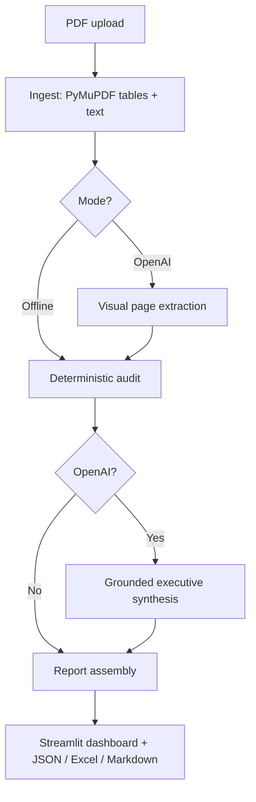

# InsightForge | Decision Intelligence for Analytical PDFs

A portfolio-ready **LangGraph PDF analysis pipeline** for source-grounded decision intelligence from complex reports (survey tables, operational dashboards, financial/market reports). Unlike simplistic line extraction, it builds **structured numerical facts**, computes **auditable like-for-like comparisons**, uses page-image understanding (optional OpenAI mode), and drafts cautious executive decision considerations.

## Demonstrated on a 39-page analytical survey report

Offline smoke test: **39 pages, 1,260 extracted numeric table cells, up to 100 audited comparisons**. These are test-run counts, **not claims of accuracy**. Some complex multi-level headers are deliberately classified as ambiguous; OpenAI adds image-based context, and vision-only values receive review flags. The supplied report is **not included in this repository** due to confidentiality and licensing considerations.

## Architecture



**Built-in review safeguards:** numeric values are traced to page/table/row/column; unknown/merged column headers do not generate arithmetic; percentage differences use **percentage points**; unlike-scope or mismatched units are not compared; image-only LLM facts are **provisional**; the project does not assert causality, statistical significance, or actual outcomes from survey data.

## Windows installation

In VS Code PowerShell, from the extracted project folder:

```powershell
python -m venv .venv
.\.venv\Scripts\python.exe -m pip install -e ".[dev]"
.\.venv\Scripts\python.exe -m pytest -v
.\.venv\Scripts\python.exe -m streamlit run decision_app.py
```

If you already have a working `.venv`, you may reuse it. Python **3.11–3.13**. The older `app.py` is preserved as the V2 baseline; **use `decision_app.py` for this release**.

### AI mode (optional, paid)

Provide a valid OpenAI API key in the same terminal **before launching Streamlit**:

```powershell
$env:OPENAI_API_KEY="YOUR_API_KEY"
.\.venv\Scripts\python.exe -m streamlit run decision_app.py
```

Choose `openai` mode and test **only 2–3 pages** initially. API usage incurs charges, and page images may increase the token bill. Do not commit keys or upload confidential reports without permission. Test structured table pages (e.g. district winner summary), then progressively add complex chart pages. Default model is `gpt-4o-mini`; not all models necessarily support the same structured output/vision features.

## Modes & quality limitations

| Feature | Offline | OpenAI |
|---|---|---|
| PDF page/table extraction | Yes | Yes |
| Numerical audit where headings are trustworthy | Yes | Yes |
| Image/chart understanding | No | Yes, model-dependent |
| Natural-language executive considerations | No | Yes, sources required |
| Unverified visual extraction | N/A | Flagged for review |
| Accuracy guaranteed / recommendations automatically approved | No | No |

**Important:** This is a careful prototype, **not** a guarantee that any arbitrary PDF yields high-quality or complete decisions. Maps, image-only charts, complex table merges and statistical uncertainty require validation and domain-specific evaluation. Calculations should not automatically be called strategic recommendations. Avoid using without expert review for decisions with significant financial, medical, legal or civic consequences.

## GitHub-ready layout

- `decision_app.py` — new Streamlit dashboard
- `src/insight_generator/decision_graph.py` — LangGraph conditional orchestration
- `src/insight_generator/decision_engine.py` — factual table extraction, metric validation, arithmetic, OpenAI vision and executive synthesis
- `app.py` and original modules — V2 benchmark retained for comparisons
- `tests/` — pytest regression suite
- `docs/DECISION_ENGINE_WALKTHROUGH.md` — thorough implementation and interview explanation
- `docs/EVALUATION.md` — validation methodology

## Test the same PDFs

1. Open **`decision_app.py`**, not the older app.
2. Upload your own PDF; use offline mode first.
3. Review *Structured metrics & QA* to see source labels and low-confidence rows.
4. Verify a handful of source values manually on the original PDF.
5. Run OpenAI mode on a few representative pages; confirm image-derived facts.
6. Review *Executive decisions*, compare all sources, and export the workbook.

## Evaluation plan before resume claims

Create a gold-standard sample of at least 30 pages spanning tables, charts, maps, and scanned content. Measure (a) table-cell precision/recall, (b) numerical correctness, (c) cited-page accuracy, (d) relevance of decision considerations, (e) review-flag recall, and (f) cost per page. Report these metrics rather than fabricated 'AI accuracy' percentages.

## Scope note

This tool can describe political survey data neutrally, including observed differences, sampling limitations and methodological sensitivity. It is not intended to optimize targeted political persuasion or voter manipulation.

## V3.1: Concise executive paragraphs (October 2026)

The **Executive decisions** tab now puts an **Executive brief** first: up to five short, related analytical paragraphs, each with page references. The previous individual AI cards remain in a collapsed *Overall assessment and detailed evidence notes* section. OpenAI mode must be selected for paragraph synthesis; offline mode remains deterministic.

The OpenAI schema now includes `paragraphs` (`heading`, `paragraph`, `source_ids`, `source_pages`) alongside the existing detailed `notes`. The application rejects paragraphs that lack recognized fact IDs, mismatch source pages, or exceed the length cap. This is *provenance checking*, not full semantic verification of every sentence. Readers must still review underlying table definitions and causal interpretations.

Additional comparison guardrails suppress row labels such as `Total`/`Subtotal`, and sample-count/margin-bucket tables. Do not treat sample-bucket counts as voter engagement statistics. The model prompt requires neutral descriptive observations and no demographic persuasion advice.

Upgrade instructions: unpack this release to a separate folder, install dependencies with `python -m pip install -e ".[dev]"`, set `OPENAI_API_KEY`, and launch `python -m streamlit run decision_app.py`. Re-run analysis after upgrading; don't reuse an old browser-session report. Test with pages 21–22 of the source report before expanding to the complete document.
