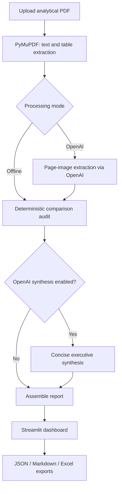

# InsightForge — PDF Decision Intelligence with LangGraph

**An evidence-aware PDF analytics application that turns tables, metrics, and report pages into traceable comparisons and concise executive briefs.**

Built with **Python · LangGraph · OpenAI API (optional) · PyMuPDF · Pydantic · Streamlit · Pandas**.

InsightForge is designed for analytical PDFs such as businsess performance reports, survey summaries, operational reviews, and financial dashboards. Rather than treating every extracted sentence as an insight, it separates **document extraction**, **deterministic calculations**, **source review**, and **AI-assisted synthesis**.

> **Project status:** Working portfolio prototype. It supports auditable numerical comparisons and optional multimodal AI analysis, but is not a substitute for expert review. Complex PDF layouts, chart extraction, and nuanced interpretations can still require manual validation.

## Why this project?

Analytical reports often contain dozens of pages of tables and visualizations. Extracting text is only the first step: a useful decision-support tool must identify comparable measurements, calculate differences correctly, connect findings across sections, and show the evidence behind each conclusion.

InsightForge addresses this with two processing modes:

| Capability                                  | Offline mode | OpenAI mode |
| ------------------------------------------- | ------------ | ----------- |
| Read pages and detect PDF tables            | Yes          | Yes         |
| Extract labeled numeric facts               | Yes          | Yes         |
| Calculate supported numeric comparisons     | Yes          | Yes         |
| Analyze rendered page images                | No           | Yes         |
| Produce short, grouped executive paragraphs | No           | Yes         |
| Preserve source pages and review flags      | Yes          | Yes         |
| Export JSON, Markdown, and Excel            | Yes          | Yes         |

## Features

- **Structured PDF extraction:** captures numerical table cells with page, topic, row, column, value, and evidence metadata.
- **Deterministic analytics:** computes comparisons only where the detected labels and units support like-for-like analysis. Percentage-point differences are distinguished from relative percentage changes.
- **LangGraph orchestration:** routes processing through ingestion, optional vision extraction, calculation audit, optional AI synthesis, and report assembly.
- **Multimodal document analysis:** in OpenAI mode, sends selected page images for additional interpretation of visually complex content.
- **Concise executive briefs:** generates up to five short, theme-based paragraphs with supporting page references, rather than a long collection of repetitive cards.
- **Review-first safeguards:** marks image-derived numeric facts as provisional and flags extraction or evidence issues for human review.
- **Interactive Streamlit dashboard:** browse executive findings, comparisons, source facts, and QA issues.
- **Portable outputs:** download a structured JSON report, an executive Markdown report, or an Excel workbook.

## System architecture



**Core orchestration:** `src/insight_generator/decision_graph.py`
**Extraction and analysis:** `src/insight_generator/decision_engine.py`
**User interface:** `decision_app.py`

### How an insight is formed

1. **Ingest:** read selected PDF pages and extract table cells with source metadata.
2. **Normalize:** represent values as structured facts with labels, units, and page references.
3. **Compare:** generate numerical findings using Python arithmetic and compatibility rules.
4. **Review:** retain ambiguous or vision-only values as issues rather than silently treating them as verified.
5. **Summarize:** optionally ask OpenAI to combine supported findings into short, readable executive paragraphs with citations.
6. **Explore and export:** inspect evidence and download the report.

**Important distinction:** cited fact IDs and page references provide provenance, but they do **not** guarantee that every AI interpretation is semantically correct.

## Quick start

### Requirements

- Python **3.11 or newer** (project configuration requires `>=3.11`; tested package compatibility may vary by environment)
- Git (optional, for cloning)
- An OpenAI API key **only** for OpenAI mode

### 1. Clone the repository

```bash
git clone https://github.com/Rahul-Ratusaria/insight_generator-langgraph.git
cd insight_generator-langgraph
```

### 2. Create and install a virtual environment

**Windows PowerShell**

```powershell
python -m venv .venv
.\.venv\Scripts\python.exe -m pip install -e ".[dev]"
```

**macOS / Linux**

```bash
python3 -m venv .venv
source .venv/bin/activate
python -m pip install -e ".[dev]"
```

### 3. Run the application

**Windows PowerShell**

```powershell
.\.venv\Scripts\python.exe -m streamlit run decision_app.py
```

**macOS / Linux**

```bash
python -m streamlit run decision_app.py
```

Open the local URL printed by Streamlit (usually `http://localhost:8501`). **Run `decision_app.py` for the current version; `app.py` is an older baseline interface.**

## OpenAI mode (optional)

OpenAI mode uses paid API requests. It is separate from a ChatGPT subscription.

Set the key in the **same terminal** that will launch Streamlit:

**Windows PowerShell**

```powershell
$env:OPENAI_API_KEY="YOUR_API_KEY"
.\.venv\Scripts\python.exe -m streamlit run decision_app.py
```

**macOS / Linux**

```bash
export OPENAI_API_KEY="YOUR_API_KEY"
python -m streamlit run decision_app.py
```

Then upload a PDF, select **openai**, select a supported model (the app defaults to `gpt-4o-mini`), and choose a small page range for the first test. The sidebar also supports limiting the number of pages sent for AI image analysis.

**Security:** Never commit an API key. Do not upload confidential, client-owned, or personal-data reports to an external model without appropriate authorization.

## Running a local demonstration

To generate the bundled synthetic test report:

```powershell
.\.venv\Scripts\python.exe scripts\make_sample.py
```

Upload `sample_analytics_report.pdf` in the Streamlit UI. Use **offline** mode first to inspect extraction and calculations without API costs. Then optionally try **openai** mode to evaluate paragraph synthesis.

The demonstration report contains synthetic figures. The project does not include third-party confidential analytical reports.

## Dashboard outputs

| Dashboard section                     | Purpose                                                         |
| ------------------------------------- | --------------------------------------------------------------- |
| **Executive decisions**         | Read short AI-generated paragraphs and optional detailed notes  |
| **Evidence-backed comparisons** | Review calculated findings, formulas, source pages, and caveats |
| **Structured metrics & QA**     | Inspect extracted facts and any review flags                    |
| **Download**                    | Export JSON, Markdown, and Excel                                |

### Example of an expected insight format

> **Revenue movement**
> Revenue increased from 1.20 million to 1.44 million, a 20% relative increase. This establishes the size of the reported change, but not its cause. Review product mix, customer volumes, pricing, and the reporting periods before attributing the growth to any specific factor.

*Illustrative example using synthetic values; actual output depends on uploaded evidence and selected mode.*

## Project structure

```text
.
├── decision_app.py                 # Current Streamlit dashboard
├── app.py                          # Earlier prototype interface
├── pyproject.toml                  # Dependencies and package metadata
├── .env.example                    # Example API variable (no credentials)
├── .gitignore
├── sample_analytics_report.pdf     # Synthetic sample report
├── scripts/
│   └── make_sample.py             # Regenerate synthetic PDF
├── src/insight_generator/
│   ├── decision_graph.py           # LangGraph nodes and conditional routing
│   ├── decision_engine.py          # Fact extraction, comparisons, AI synthesis
│   ├── pdf.py                      # PDF utilities from baseline implementation
│   ├── analytics.py                # Baseline analytics utilities
│   ├── provider.py                 # Model integration utilities
│   ├── validation.py               # Evidence validation utilities
│   ├── service.py                   # Baseline processing service
│   ├── storage.py                   # Baseline persistence utilities
│   ├── export.py                    # Baseline exports
│   └── cli.py                       # Command-line entry point
├── tests/                          # Automated tests
├── docs/                           # Architecture, evaluation, walkthroughs
└── .github/workflows/test.yml      # Continuous integration
```

## Testing

Run the automated test suite:

**Windows PowerShell**

```powershell
.\.venv\Scripts\python.exe -m pytest -v
```

**macOS / Linux**

```bash
python -m pytest -v
```

Tests cover parsing, comparison logic, evidence checks, and baseline regression behavior. A successful unit test run is **not** proof of accuracy on arbitrary PDFs; always evaluate representative real-world documents separately.

## Limitations and responsible use

- Table extraction is sensitive to layout, merged headers, scanned pages, and image-only charts.
- Automated comparisons are intentionally conservative; some legitimate comparisons may be omitted when units or labels are unclear.
- OpenAI-generated descriptions and interpretations may still be incorrect, even when page references are provided.
- This project does not claim causal inference, statistical significance, comprehensive OCR, or reliable automatic recommendations for all documents.
- Findings should be checked against source pages before making consequential business decisions.
- Political survey reports should be treated descriptively, with appropriate methodological caveats; the project is not intended for targeted political persuasion.

## Further development

Possible extensions include semantic cross-page metric alignment, better chart and map parsing, human approval workflows, automated evaluation datasets, uncertainty-aware ranking, and report-type-specific analytical templates.

## Documentation

- [Decision engine walkthrough](docs/DECISION_ENGINE_WALKTHROUGH.md)
- [Architecture](docs/ARCHITECTURE.md)
- [Evaluation approach](docs/EVALUATION_V3.md)
- [Project walkthrough](docs/PROJECT_WALKTHROUGH.md)

## Author

**Rahul Ratusaria**
[GitHub](https://github.com/Rahul-Ratusaria)

---

*InsightForge is a portfolio project showcasing LangGraph orchestration, document analysis, deterministic analytics, and evidence-aware LLM synthesis.*
